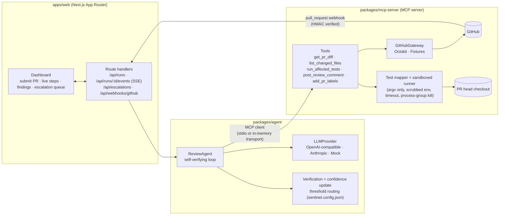
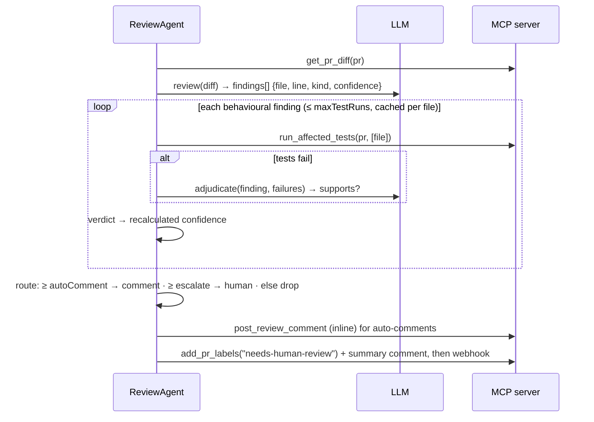

# PR Sentinel — Agentic Code Review Harness

[](https://github.com/ajaychauhan29dev-cell/pr-sentinel/actions/workflows/ci.yml)

PR Sentinel is a Next.js app plus a custom **MCP (Model Context Protocol) server** that gives an LLM agent GitHub tools: diff retrieval, test execution and comment posting. Its review loop **checks its own work**. The agent reads a PR diff and proposes findings with confidence scores. It then **runs the affected tests to confirm or refute each behavioural finding** before it comments. Configurable thresholds decide what gets auto-posted, what gets **escalated to a human**, and what gets dropped.

```
F3 Boundary condition changed from `>=` to `>`   confirmed      0.62 → 0.85  → auto-comment
F2 Error is silently swallowed                   inconclusive   0.70 → 0.63  → escalate to human
F4 Defensive default removed                     refuted        0.58 → 0.20  → drop
```

## Architecture



### The review loop



**Verdicts and confidence updates** (every factor is configurable):

| Evidence | Verdict | New confidence |
|---|---|---|
| Static finding (style, TODO, secrets…) | `not_applicable` | unchanged |
| Affected tests fail **and** the LLM agrees the failure is caused by this issue | `confirmed` | `c + (1 − c) × confirmBoost` |
| Affected tests fail for an unrelated reason | `inconclusive` | `c × inconclusiveFactor` |
| Affected tests all pass | `refuted` | `c × refuteFactor` |
| No tests cover the file / timeout / runner error | `inconclusive` | `c × inconclusiveFactor` |
| Test-run budget exhausted / verification disabled | `skipped` | `c × inconclusiveFactor` |

Routing (`packages/agent/src/routing.ts`): `confidence ≥ autoComment` → inline comment. `escalate ≤ confidence < autoComment` → human. Anything lower is dropped. Categories in `alwaysEscalateCategories` (default `security`) always go to a human. Comment-worthy findings beyond `limits.maxComments` are escalated, not silently dropped.

### Repository layout

```
packages/mcp-server   MCP server (official @modelcontextprotocol/sdk), Octokit + fixture gateways,
                      test-file mapper, sandboxed test runner, git workspace provider, stdio bin
packages/agent        ReviewAgent loop, providers (OpenAI-compatible, Anthropic, Mock), prompts +
                      zod-validated output parsing, verification, routing, escalation, CLI
apps/web              Next.js 16 dashboard, SSE run stream, escalation queue, GitHub webhook
examples/             Offline demo: fixture PR (demo/acme-shop#42) + its head checkout (node:test)
sentinel.config.json  Threshold / verification / escalation policy
```

## MCP tools

| Tool | Description | Side effects |
|---|---|---|
| `get_pr_diff` | PR metadata and a unified diff of all changed files (size-capped) | none |
| `list_changed_files` | Changed files with status and +/- counts | none |
| `run_affected_tests` | Maps changed files to test files (co-located, `__tests__`, mirrored `test/`/`tests/` trees) and runs them against the PR head in a sandboxed child process with a timeout. Returns status, counts, parsed failures and an output excerpt | runs code in the workspace |
| `post_review_comment` | Inline comment (path and line on the head commit) or a summary comment | writes to GitHub unless dry-run |
| `add_pr_labels` | Adds labels (used for escalation) | writes to GitHub unless dry-run |

Run it as a standalone MCP server over stdio. It works with any MCP client, e.g. Claude Desktop or the MCP Inspector:

```bash
npm run build
GITHUB_TOKEN=ghp_... SENTINEL_DRY_RUN=true node packages/mcp-server/dist/bin.js
# or: npx @modelcontextprotocol/inspector node packages/mcp-server/dist/bin.js
```

**Dry-run mode:** with `SENTINEL_DRY_RUN=true`, or a per-call `dryRun: true`, write tools record into an outbox and never call GitHub. Without a `GITHUB_TOKEN`, the server enters demo mode: it serves the fixture PR and always runs in dry-run.

## Setup

Requires Node.js ≥ 20.9 and git.

```bash
npm install
cp .env.example .env   # optional: everything works offline without it
```

### Environment variables

| Variable | Purpose | Default |
|---|---|---|
| `GITHUB_TOKEN` | GitHub token for Octokit. Leave unset for offline demo mode | — |
| `GITHUB_API_URL` | GitHub Enterprise API base URL | api.github.com |
| `GITHUB_WEBHOOK_SECRET` | Verifies `X-Hub-Signature-256` on `/api/webhooks/github` | — (webhook disabled) |
| `LLM_PROVIDER` | `mock` \| `openai` \| `anthropic` | `mock` |
| `OPENAI_API_KEY`, `OPENAI_BASE_URL`, `OPENAI_MODEL` | Any OpenAI-compatible endpoint | `https://api.openai.com/v1`, `gpt-4o-mini` |
| `ANTHROPIC_API_KEY`, `ANTHROPIC_MODEL` | Anthropic Messages API | `claude-sonnet-4-5` |
| `SENTINEL_DRY_RUN` | Record writes instead of sending them | `false` (forced on in demo) |
| `SENTINEL_TEST_COMMAND` | Test command template; `{files}` expands to the affected tests | `node --test --test-reporter=tap {files}` |
| `SENTINEL_TEST_TIMEOUT_MS` | Kill test runs after this long | `120000` |
| `SENTINEL_WORKSPACE_DIR` | Where PR heads are shallow-fetched | `.sentinel-workspaces` |
| `SENTINEL_INSTALL_COMMAND` | Optional sandboxed install after checkout (e.g. `npm ci --ignore-scripts`) | — |
| `SENTINEL_CONFIG` | Path to `sentinel.config.json` for the web app | repo root |

## Running the demo (offline, mock provider)

The demo PR `demo/acme-shop#42` (`examples/fixtures/demo-pr.json`) includes a real off-by-one regression, a leftover `console.log`, a removed null guard and a swallowed error. Its head checkout lives in `examples/demo-repo`, and its tests really run.

**CLI** (spawns the MCP server over stdio):

```bash
npm run demo
# = npm run build && node packages/agent/dist/cli.js review demo/acme-shop#42 --provider mock --dry-run
# add --json for the full report, --transport memory to run the server in-process
```

**Dashboard:**

```bash
npm run dev            # builds packages, then starts Next.js on http://localhost:3000
```

Submit `demo/acme-shop#42` and watch the steps stream in. Each finding shows its verification evidence: the test command, the failing test names and the output. Open **Escalation queue** to approve (post) or dismiss escalated findings.

**Against a real PR:** set `GITHUB_TOKEN` and `SENTINEL_TEST_COMMAND` for the target repo (e.g. `npx vitest run {files}`, plus `SENTINEL_INSTALL_COMMAND="npm ci --ignore-scripts"`). Pick a provider, then run:

```bash
LLM_PROVIDER=openai OPENAI_API_KEY=... node packages/agent/dist/cli.js review https://github.com/owner/repo/pull/123 --dry-run
```

Remove `--dry-run` (and leave `SENTINEL_DRY_RUN` unset) to actually post.

## Tests, typecheck and lint

```bash
npm test          # vitest across all workspaces
npm run typecheck # builds packages, then tsc --noEmit everywhere (incl. tests)
npm run lint      # eslint + typescript-eslint
```

What's covered:
- **mcp-server:** PR ref parsing, test mapping and path-traversal rejection, sandbox (exit codes, timeout kills the process group, secrets don't leak into the child env, output caps), command building without a shell, TAP/Vitest/Jest output parsing, and every MCP tool through a real MCP client over an in-memory transport (including dry-run vs. live writes).
- **agent:** threshold routing (boundaries, always-escalate categories, comment cap), confidence recalculation, verdict assessment, LLM adjudication, config validation, model-output parsing, provider adapters (request shape, retry and backoff), and **end-to-end loop runs over MCP** that execute the demo repo's real tests: confirm/refute/escalate, dry-run, the `maxTestRuns` budget, and verification on vs. off.
- **web:** webhook HMAC verification and event filtering.

CI (`.github/workflows/ci.yml`) runs lint → typecheck → tests → offline demo → `next build` on Node 20 and 22.

## Configuration (`sentinel.config.json`)

```json
{
  "thresholds": { "autoComment": 0.8, "escalate": 0.5 },
  "verification": { "enabled": true, "adjudicate": true, "confirmBoost": 0.6, "refuteFactor": 0.35, "inconclusiveFactor": 0.9, "maxTestRuns": 5 },
  "alwaysEscalateCategories": ["security"],
  "limits": { "maxFindings": 20, "maxComments": 10 },
  "escalation": { "label": "needs-human-review", "mentions": ["@org/reviewers"], "webhookUrl": "https://hooks.slack.com/..." },
  "summaryComment": true
}
```

The config is validated with zod. Unknown keys, out-of-range values and `escalate > autoComment` are rejected.

## Design notes and limitations

- **Sandboxing:** tests run as a child process with no shell, an allowlisted environment (no tokens or API keys), a throwaway `HOME`, a timeout that SIGKILLs the whole process group, and bounded output. This is process-level isolation, **not a security boundary**. Untrusted PRs from forks should run inside a container or microVM (e.g. run the MCP server in Docker with no network). The runner interface is designed so that swap is straightforward.
- **Attribution:** a failing test counts as confirmation only after the LLM adjudicates that the failure matches the finding. Comparing against a base-branch run (to exclude pre-existing failures) is a natural next step.
- **Persistence:** runs and the escalation queue live in memory in the Next.js process. That's fine for a single instance. Production would use Postgres/Redis and a job queue for webhook-triggered runs.
- **Mock provider:** deterministic heuristics, not an LLM. It emits exactly the JSON a real model is asked for, so the whole pipeline (parsing, verification, routing, delivery) is exercised offline and in CI. The OpenAI-compatible and Anthropic adapters are tested at the HTTP-contract level with a mocked `fetch`. They haven't been exercised against live APIs in CI.
- **Webhook runs** use the configured provider and `SENTINEL_DRY_RUN`. GitHub App installation-token auth is not implemented; the server uses a single `GITHUB_TOKEN`.

## License

[MIT](LICENSE) © 2026 Ajay Chauhan
